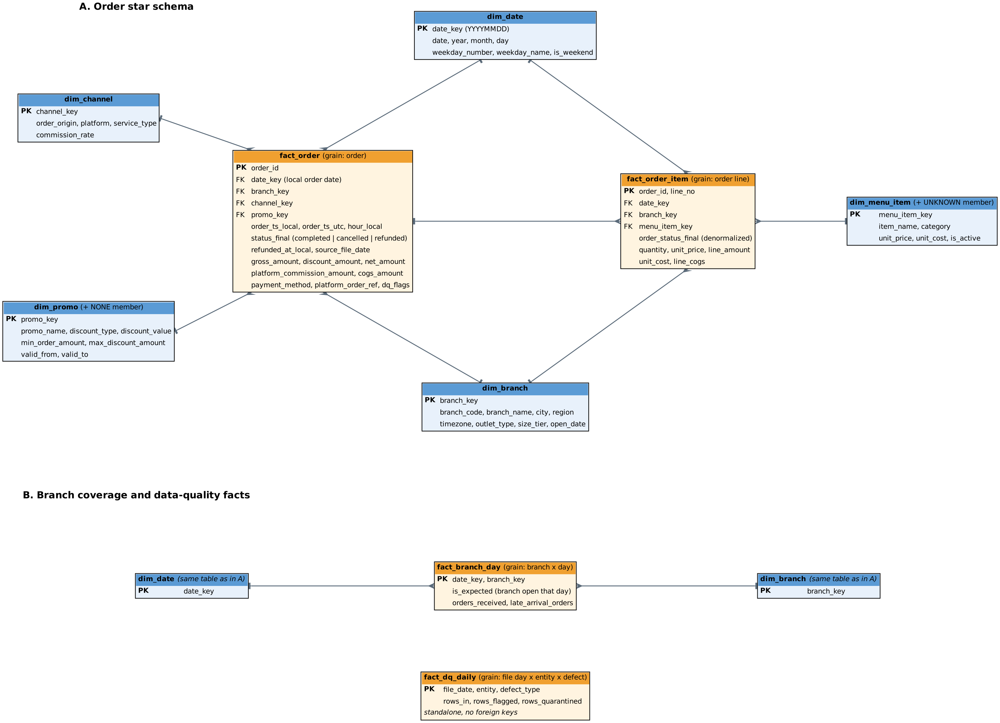

# Data model (Check Point 1)

Status: design for Mentoring 1. Layer details are provisional until the Phase 3 pipeline design is approved.

Panel B repeats `dim_date` and `dim_branch` only to keep the lines from crossing. They are the same tables as in panel A. Source: `er_diagram.dot`, rendered with `neato -n2 -Tsvg`.

## Layers (provisional)

| Layer | Content | Format and partitioning |
|---|---|---|
| raw | Generator output exactly as delivered | CSV on S3-compatible storage, `<entity>/dt=<file date>/` |
| bronze | Raw rows plus `source_file_date`, no cleaning | Parquet |
| silver | Deduplicated, standardized, timestamps converted, `order_changes` applied, defects quarantined | Parquet partitioned by `order_date` |
| gold | Star schema below | DuckDB / Parquet |
| marts | Small aggregates for the dashboard | PostgreSQL database `analytics`, read by Metabase |

Refunds and cancellations are attributed to the order date. A refund therefore rewrites the `order_date` partition of its order, up to 8 days back. Late-arriving orders (file date later than order date) land in their own order-date partition.

## Raw CSV contract (generator output)

| Entity | Key | Columns |
|---|---|---|
| orders | order_id | branch_id, channel_id, order_ts (branch local time, no offset), status (completed or cancelled), gross_amount, discount_amount, promo_id, total_amount, platform_commission_amount, payment_method, platform_order_ref |
| order_items | order_id, line_no | menu_item_id, quantity, unit_price, line_amount |
| order_changes | change_id | order_id, previous_status, new_status (refunded), changed_at |
| dimensions/branches | branch_id | branch_code, branch_name, city, region, timezone, outlet_type, size_tier, open_date |
| dimensions/menu_items | menu_item_id | item_name, category, unit_price, unit_cost, is_active |
| dimensions/promos | promo_id | promo_name, discount_type, discount_value, min_order_amount, max_discount_amount, valid_from, valid_to, channel_scope, weekday_scope |
| dimensions/channels | channel_id | order_origin, platform, service_type, commission_rate |

Channels: `offline_dine_in`, `offline_takeaway`, `grabfood`, `gofood`, `shopeefood`. Cloud kitchen versus physical restaurant for online orders is `dim_branch.outlet_type`, not a channel. Discount lives at order level only. `unit_cost` (COGS) is static per menu item.

## Gold: how raw becomes gold

| Gold column | Rule |
|---|---|
| fact_order.gross_amount | Recomputed as the sum of the order's item `line_amount` (the raw value can disagree) |
| fact_order.net_amount | gross_amount minus discount_amount |
| fact_order.status_final | `refunded` if a refund change exists, otherwise the raw status |
| fact_order.order_ts_utc | Local time converted with `dim_branch.timezone` (WIB, WITA, WIT) |
| fact_order.cogs_amount | Sum of quantity times `unit_cost` over the order's items |
| fact_order.source_file_date | File date the order arrived in (late-arrival detection) |
| fact_order.dq_flags | Defect markers set during cleaning |
| dim_menu_item UNKNOWN, dim_promo NONE | Fallback members so every foreign key resolves |

## Every metric maps to gold

| # | Priority | Metric | Source in gold |
|---|---|---|---|
| M1 | P1 | Net Sales | fact_order.net_amount, status_final = completed |
| M2 | P1 | Completed Orders | count of fact_order, status_final = completed |
| M3 | P1 | Average Order Value | M1 divided by M2 |
| M4 | P1 | Cancellation Rate | cancelled orders over all orders, fact_order |
| M5 | P2 | Refund Rate | refunded over (completed + refunded), fact_order |
| M6 | P1 | Net Sales Mix by Channel | M1 by channel_key |
| M7 | P1 | Channel Contribution Margin | net_amount, cogs_amount, platform_commission_amount by channel |
| M8 | P1 | Net Sales per Branch-Day | M1 by branch and day; denominator from fact_branch_day |
| M9 | P2 | Branch Performance Index | 28-day rolling M8 over peer median (dim_branch region and outlet_type) |
| M10 | P1 | Order Volume by Hour and Weekday | fact_order.hour_local, dim_date.weekday_number |
| M11 | P2 | Peak-Hour Load | 95th percentile of M10 per branch |
| M12 | P1 | Item Sales Mix | fact_order_item.line_amount and quantity by menu_item_key |
| M13 | P2 | Item Gross Margin % | fact_order_item.line_amount and line_cogs |
| M14 | P2 | Beverage Attach Rate | fact_order_item joined to dim_menu_item.category |
| M15 | P1 | Discount Rate | discount_amount over gross_amount, completed, by promo_key |
| M16 | P2 | Promo AOV Lift | AOV with promo_key other than NONE versus NONE |
| M17 | P1 | Branch Reporting Coverage | fact_branch_day.orders_received over is_expected |
| M18 | P2 | Quarantine and Late-Arrival Rate | fact_dq_daily and fact_branch_day.late_arrival_orders |

`is_expected` is derived from `dim_branch.open_date`, not from the generator manifest. The manifest is only used by tests to validate data quality checks.
